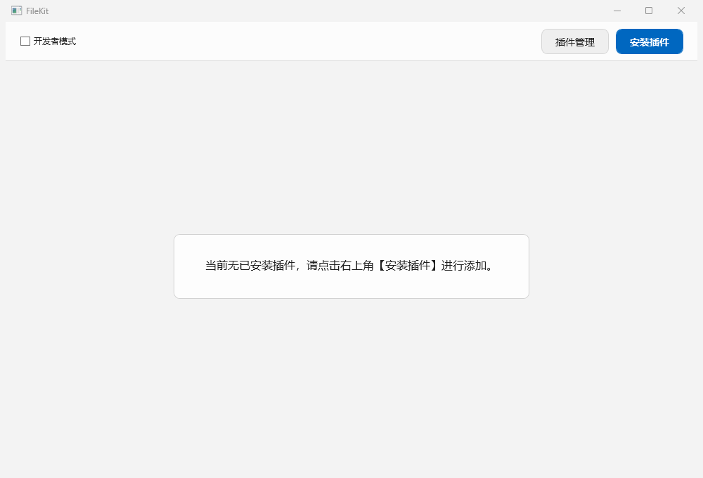
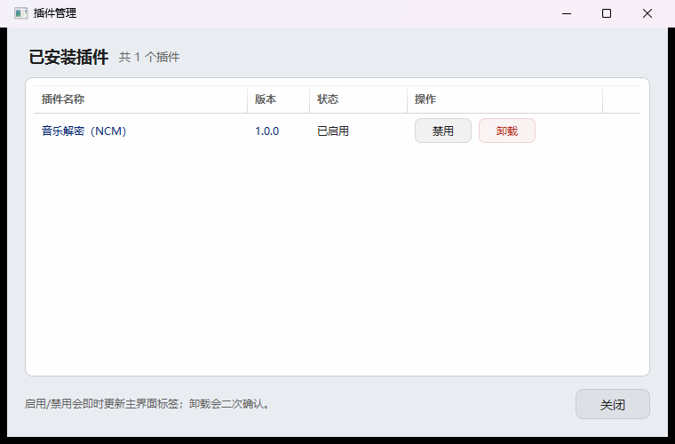
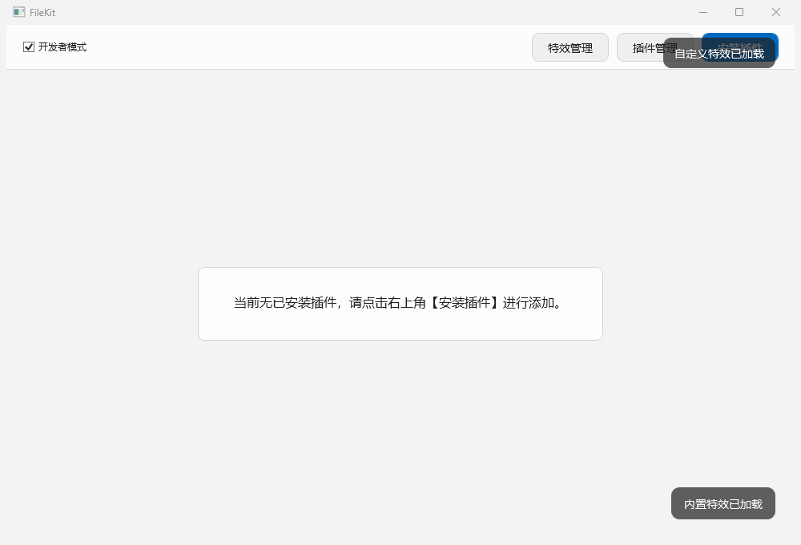
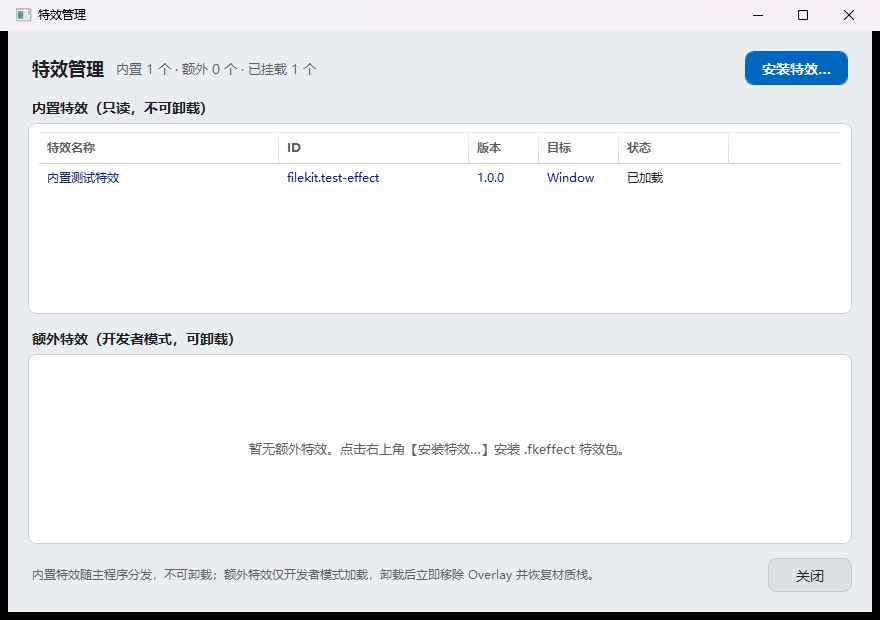
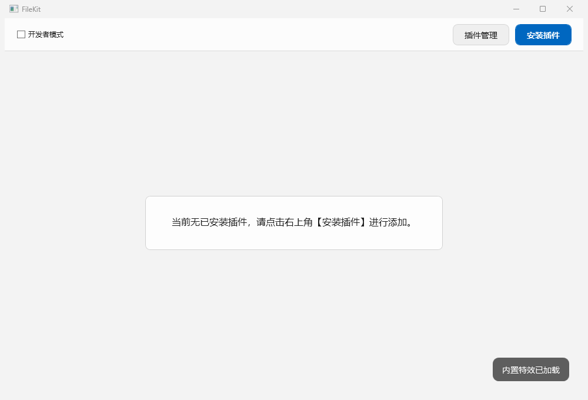

# FileKit 项目完整文档

> Windows 文件工具宿主 + 业务插件系统 + 视觉特效插件系统
> 技术栈：.NET 8 / WPF / C#，无第三方 DI 容器；目标框架 `net8.0-windows`。
> 当前版本：Host `1.0.0`，已完成 M1（宿主与 DWM 材质）、M2（业务插件）、M3（特效插件与开发者模式）及后续启动健壮性修复。

---

## 目录

- [1. 项目概览](#1-项目概览)
- [2. 功能总览](#2-功能总览)
- [3. 架构与解决方案结构](#3-架构与解决方案结构)
- [4. 环境要求与构建运行](#4-环境要求与构建运行)
- [5. 数据目录与路径策略](#5-数据目录与路径策略)
- [6. M1：宿主壳与 DWM 材质](#6-m1宿主壳与-dwm-材质)
- [7. M2：业务插件系统](#7-m2业务插件系统)
- [8. M3：特效插件系统](#8-m3特效插件系统)
- [9. 开发者模式](#9-开发者模式)
- [10. 运行时关键类参考](#10-运行时关键类参考)
- [11. 测试与验证](#11-测试与验证)
- [12. 人工验收清单](#12-人工验收清单)
- [13. 排障](#13-排障)
- [14. 已知边界与设计决策](#14-已知边界与设计决策)
- [15. 变更记录](#15-变更记录)
- [16. 仓库清理说明](#16-仓库清理说明)

---

## 1. 项目概览

FileKit 是一个可扩展的 Windows 桌面文件工具宿主。项目分三个里程碑演进：

| 里程碑 | 内容 |
|---|---|
| **M1** | WPF 宿主窗口、DWM Mica/Acrylic 背景材质申请与逐级降级（纯色兜底）、统一视觉风格与动画 |
| **M2** | 业务插件系统：`.fkpkg` 包、manifest 校验、版本兼容、ALC 隔离加载、安装/启用/禁用/卸载、pendingDelete、`plugins.json` 持久化、插件标签页与插件管理弹窗 |
| **M3** | 特效插件系统：`.fkeffect` 包、冻结契约 `Contracts.Effects`、EffectManager、材质栈、Overlay 层、内置测试特效、开发者模式、特效管理弹窗与安装/卸载交互 |

设计原则：

- 宿主只负责加载、生命周期与 UI 协调；插件/特效只通过契约与宿主交互。
- 一个插件/特效一个可回收 `AssemblyLoadContext`，共享契约回退 Default ALC。
- 单个插件/特效失败只记录日志并跳过，不影响主程序与其他扩展。
- 不使用第三方 DI，全部在 Host 中手动 `new`。

核心界面：



---

## 2. 功能总览

- **窗口材质**：Windows 11 Mica / Acrylic，自动检测系统能力与透明效果设置，失败时纯色降级；运行时支持特效通过材质栈切换并恢复。
- **业务插件**：安装 `.fkpkg`、自动生成标签页、启用/禁用、卸载；卸载被占用时走 pendingDelete，下次启动自动清理。
- **特效插件**：内置特效 + 开发者 `.fkeffect`；材质覆盖入栈/出栈、Overlay 注册、加载提示自动淡出。
- **开发者模式**：
  - 命令行 `--developer-mode`（最高优先级，强制开启）；
  - 界面顶部左侧复选框，勾选即时切换并持久化；
  - 关闭开发者模式时卸载 dev 特效但保留磁盘文件。
- **健壮性**：启动异常落盘、数据目录可写回退、受限 TEMP 环境光标缓存重定向，避免“双击无反应/打开弹窗闪退”。

---

## 3. 架构与解决方案结构

### 3.1 项目边界

| 项目 | 目标框架 | 引用 | 职责 |
|---|---|---|---|
| `FileKit.Contracts` | `net8.0-windows`（`UseWPF=true`） | — | 纯契约：`IFileKitPlugin`、`IPluginContext`、`Contracts.Effects.*` |
| `FileKit.PluginManager` | `net8.0-windows`（WPF） | Contracts | 业务插件安装/卸载/ALC/状态；内部工具供 EffectManager 复用 |
| `FileKit.EffectManager` | `net8.0-windows`（WPF） | Contracts、PluginManager | 特效扫描/校验/ALC 加载/两阶段安装/卸载/pendingDelete/日志 |
| `FileKit.Host` | `net8.0-windows`（`WinExe`） | Contracts、PluginManager、EffectManager | 主窗口、材质、Overlay、插件/特效会话协调、管理弹窗 |
| `FileKit.TestPlugin` | `net8.0-windows`（WPF） | Contracts | M2 示例业务插件（`test.fkpkg`） |
| `FileKit.TestEffect` | `net8.0-windows`（WPF） | Contracts | M3 内置测试特效（`effects\builtin\filekit.test-effect`） |
| `FileKit.TestEffects` | `net8.0-windows`（WPF） | Contracts | M3 人工验收用 dev 样例特效（不加入 sln、不被 Host 引用） |

> `FileKit.TestEffects` 仅用于生成 `.fkeffect` 样例包；正式运行时 Host 只依赖 Contracts / PluginManager / EffectManager。

### 3.2 解决方案与目录

```text
F/
├─ FileKit.sln
├─ README.md                       # 本文档
├─ .gitignore
├─ build-test-plugin.ps1           # 构建 FileKit.TestPlugin 并打包 test.fkpkg
├─ build-effects.ps1               # 构建 FileKit.TestEffects 并打包 6 个 .fkeffect 样例
├─ test.fkpkg                      # M2 示例插件包（根目录）
├─ docs/
│  └─ images/                      # 文档截图
├─ effects/
│  └─ builtin/
│     └─ filekit.test-effect/      # 内置特效源（manifest.json；构建时 staged 到输出目录）
├─ FileKit.Contracts/
│  ├─ IFileKitPlugin.cs
│  ├─ IPluginContext.cs
│  └─ Effects/
│     ├─ BackdropType.cs
│     ├─ EffectTarget.cs
│     ├─ IEffectHost.cs
│     └─ IFileKitEffect.cs
├─ FileKit.PluginManager/          # M2 底层（源码保持 M2 原样，仅 csproj 增加 InternalsVisibleTo）
├─ FileKit.EffectManager/          # M3 底层
├─ FileKit.Host/                   # 宿主（主窗口/材质/协调器/弹窗）
├─ FileKit.TestPlugin/             # M2 示例插件
├─ FileKit.TestEffect/             # M3 内置特效
└─ FileKit.TestEffects/            # M3 样例特效（验收用）
```

Host 输出目录（构建后）：

```text
FileKit.Host/bin/Release/net8.0-windows/
├─ FileKit.Host.exe
├─ FileKit.Host.dll / runtimeconfig.json / deps.json
├─ FileKit.Contracts.dll / FileKit.PluginManager.dll / FileKit.EffectManager.dll
├─ effects/builtin/filekit.test-effect/{manifest.json, libs/FileKit.TestEffect.dll}
└─ FileKitData/                    # 受限环境下的运行时数据根（见第 5 节）
```

---

## 4. 环境要求与构建运行

### 4.1 环境

- Windows 10 / 11（Mica/Acrylic 需要 Windows 11；Windows 10 自动纯色降级）
- .NET SDK 8.0+（含 `Microsoft.WindowsDesktop.App` 运行时）
- Windows PowerShell 5.1+（打包脚本要求）
- 可选：Visual Studio 2022 / Rider

### 4.2 构建

```powershell
dotnet build FileKit.sln -c Release --nologo
```

> 在受限沙箱/无命名管道环境里 MSBuild 并行构建可能静默失败，使用：
> `dotnet build FileKit.sln -c Release --nologo -m:1 -p:BuildInParallel=false`

构建成功后内置特效会自动 staged 到 `FileKit.Host\bin\Release\net8.0-windows\effects\builtin\filekit.test-effect\`（由 Host csproj 的 `StageBuiltinEffects` 目标完成）。

### 4.3 运行

```powershell
# 普通模式
.\FileKit.Host\bin\Release\net8.0-windows\FileKit.Host.exe

# 开发者模式（强制）
.\FileKit.Host\bin\Release\net8.0-windows\FileKit.Host.exe --developer-mode
```
# 点击.exe也可以直接启动
> 运行 exe 时请保留整个输出目录（依赖 DLL 与 `effects\builtin` 都在同目录）。

### 4.4 打包示例

```powershell
# M2：构建 TestPlugin 并生成根目录 test.fkpkg
powershell -NoProfile -ExecutionPolicy Bypass -File .\build-test-plugin.ps1

# M3：构建样例特效并生成 artifacts\manual-test\*.fkeffect（6 个包）
powershell -NoProfile -ExecutionPolicy Bypass -File .\build-effects.ps1
```

M3 样例包清单：

| 包 | effectId | 用途 |
|---|---|---|
| `test.fkeffect` | `filekit.dev.custom-overlay` | 自定义 Overlay 提示（1.5s 后淡出） |
| `effect-a.fkeffect` | `filekit.dev.material-a` | Push Mica + 常驻「特效 A（Mica）」标签 |
| `effect-b.fkeffect` | `filekit.dev.material-b` | Push Acrylic + 常驻「特效 B（Acrylic）」标签 |
| `bad-throwing.fkeffect` | `filekit.dev.faulty` | Attach 抛异常，用于异常隔离验收 |
| `bad-invalid-target.fkeffect` | `filekit.dev.invalid-target` | `target=window` 小写，预期被拒绝 |
| `bad-missing-manifest.fkeffect` | `filekit.dev.missing-manifest` | 缺 manifest.json，预期被拒绝 |

---

## 5. 数据目录与路径策略

### 5.1 数据根目录

Host 启动时按以下顺序选择**第一个可写**目录作为数据根：

1. `%LOCALAPPDATA%\FileKit`（默认）
2. `<exe 目录>\FileKitData`（受限/只读环境回退，本机实际使用）
3. `%TEMP%\FileKitData`（最后兜底）

目录结构：

```text
<DataRoot>/
├─ plugins/              # 业务插件安装目录（M2）
├─ data/                 # 插件数据目录
├─ effects/
│  └─ dev/               # 开发者模式额外特效（M3）
├─ logs/
│  ├─ plugin-manager.log # 业务插件日志
│  └─ effects.log        # 特效日志
├─ plugins.json          # 业务插件状态（M2）
├─ developer.json        # 开发者模式勾选状态（M3）
└─ Temp/                 # 受限 TEMP 环境下的 WPF 临时缓存（光标等）
```

### 5.2 临时目录修复（重要）

Windows 上 WPF 的 `GridViewColumnHeader` 加载拖拽光标时需要写 `%TEMP%\WPF\*.tmp`。若 `%TEMP%` 不可写（受限账户/只读环境），打开【插件管理】会抛 `UnauthorizedAccessException` 并闪退。

Host 在 `App.OnStartup` 最早阶段调用 `HostPaths.EnsureWritableTemp()`：

- 探测默认 TEMP 是否可写；
- 不可写时把进程级 `TEMP`/`TMP` 重定向到 `<DataRoot>\Temp`；
- 默认 TEMP 可写时不做任何改变。

### 5.3 启动异常日志

`App` 在创建主窗口前安装全局异常兜底（`DispatcherUnhandledException` / `AppDomain.UnhandledException`），任何启动/UI 未处理异常写入：

- `<exe 目录>\startup-error.log`
- 或 `<DataRoot>\logs\startup-error.log`（视可写性）

避免 WinExe 在无控制台环境下“静默闪退”。

---

## 6. M1：宿主壳与 DWM 材质

- 主窗口为无边框感 WPF 窗口，使用 `RootLayout` 承载顶栏与内容区，整体配色/圆角/动画保持统一。
- `FileKit.Host/Services/WindowMaterialService.cs`：
  - 检测注册表 `EnableTransparency`、`DwmIsCompositionEnabled`、Windows build；
  - build ≥ 22621：`DwmSetWindowAttribute(DwmwaSystemBackdropType, DwmsbtMainWindow)`，失败尝试 Acrylic；
  - build 22000：旧 `DwmwaMicaEffect`；
  - 成功后 `DwmExtendFrameIntoClientArea(-1)` 并把 WPF 合成背景设为透明；
  - 任一步失败：纯色 `SurfaceFallbackBrush` 兜底，不抛异常。
- `FileKit.Host/Interop/DwmApi.cs`：最小 DWM P/Invoke 封装。
- 材质逻辑对后续特效系统暴露的能力：栈空时调用 `WindowMaterialService.TryApply(hwnd)` 恢复默认。

---

## 7. M2：业务插件系统

### 7.1 契约

```csharp
public interface IFileKitPlugin : IDisposable
{
    void Initialize(IPluginContext context);
    UserControl CreateMainView();
}

public interface IPluginContext
{
    string HostVersion { get; }
    string PluginId { get; }
    string DataDirectory { get; }
}
```

`IFileKitPlugin` / `IPluginContext` 为 M2 冻结契约，M3 未修改。

### 7.2 包格式（.fkpkg）

- 本质 ZIP；根目录必须且仅有一个 `manifest.json`，其余文件必须位于 `libs/`。
- 必填字段：`id, name, version, minHostVersion, entryAssembly, entryType`。
- 版本三段式 `major.minor.patch`；要求 `HostVersion >= minHostVersion`，缺失/格式错误拒绝安装。
- `entryAssembly` 必须在 `libs/` 下且为 `.dll`；`entryType` 必须实现 `IFileKitPlugin`、公开非抽象、公共无参构造。
- 安全：Zip Slip/绝对路径/盘符/`..`/重复 entry/越界路径全部拒绝；解压到 staging 后再原子切换目录。

### 7.3 ALC 隔离

- 每个插件一个 `PluginLoadContext`（`isCollectible: true`，名称 `FileKit.Plugin.{id}`）。
- `FileKit.Contracts` 在 `Load` 中返回 `null`，回退 Default ALC，保证插件实例与宿主接口类型一致。
- 其他依赖：`AssemblyDependencyResolver` → `libs/{name}.dll`，解析结果必须仍在当前插件 `libs/` 内。
- 卸载顺序：`PluginUnloading`（Host 拆 Tab/清理）→ `Dispose()` → `ALC.Unload()` → 强制 GC 释放文件句柄。

### 7.4 安装 / 启用 / 禁用 / 卸载

- **安装**：校验+解压 staging（失败零副作用）→ 旧插件若已加载先卸载 → 备份旧目录 → 移动新目录 → 删除备份 → 更新记录 → 按旧启用状态重新加载。
- **启用**：重建 ALC、加载、初始化、生成 `UserControl`。
- **禁用**：触发 UI 拆卸 → Dispose → Unload → 记录 `enabled=false`。
- **卸载**：卸载运行时后删除目录；删除失败改名 `{id}_pending_delete_{yyyyMMddHHmmssfff}`，下次启动清理；改名也失败提示“卸载失败，请重启后再试”。

### 7.5 状态持久化

`<DataRoot>\plugins.json`：

```json
[
  {
    "id": "filekit.test-plugin",
    "version": "1.0.0",
    "directoryPath": "C:\\...\\plugins\\filekit.test-plugin",
    "enabled": true
  }
]
```

- 文件损坏/结构非法：重置为 `[]`，不崩溃。
- 写入使用临时文件原子替换。
- `directoryPath` 必须位于 plugins 根内，防止被篡改后误删外部目录。

### 7.6 Host UI

- 主窗口右上角【插件管理】【安装插件】。
- 安装/启用后动态生成 `TabItem`（名称/版本/状态），选中第一个；禁用/卸载后按“下一个→上一个→空状态”切换。
- 插件管理弹窗：



- 逐行启用/禁用、卸载（二次确认）；错误使用 MessageBox 并附日志路径；启动加载失败只记日志不弹窗。

### 7.7 示例插件

- `FileKit.TestPlugin/TestPlugin.cs`：视图显示“测试插件已成功加载！”+ PluginId/HostVersion/DataDirectory。
- `build-test-plugin.ps1` 生成根目录 `test.fkpkg`（`id=filekit.test-plugin`）。

---

## 8. M3：特效插件系统

### 8.1 契约（FileKit.Contracts.Effects，冻结）

```csharp
public enum BackdropType { None, Mica, Acrylic }
public enum EffectTarget { Window, TabBar, Surface, Overlay }

public interface IEffectHost
{
    nint WindowHandle { get; }
    void PushBackdrop(string effectId, BackdropType type);
    void PopBackdrop(string effectId);
    void RegisterOverlay(System.Windows.FrameworkElement element, int zIndex);
    void UnregisterOverlay(System.Windows.FrameworkElement element);
}

public interface IFileKitEffect : IDisposable
{
    string EffectId { get; }
    EffectTarget Target { get; }
    void Attach(IEffectHost host);
    void Detach();
}
```

语义：

- `PushBackdrop` 同 effectId = 更新并置顶；`PopBackdrop` 移除该 id 全部条目；栈空恢复 M1 默认材质。
- 每个特效拿到绑定自身 `effectId` 的门面；越权 id 以绑定 id 为准并记录日志。
- Overlay 注册/注销在 UI 线程执行；元素按 effectId 归属，特效之间不能互相操作。
- Attach/Detach 不得长耗时（耗时初始化特效内部 async）；Host 对每个特效独立 try-catch。

### 8.2 包格式（.fkeffect）与 manifest

- ZIP；根目录 `manifest.json`；其余必须在 `libs/`。
- 必填字段：

```json
{
  "effectId": "filekit.dev.custom-overlay",
  "name": "自定义 Overlay 特效",
  "version": "1.0.0",
  "minHostVersion": "1.0.0",
  "entryAssembly": "libs/FileKit.TestEffects.dll",
  "entryType": "FileKit.TestEffects.CustomOverlayEffect",
  "target": "Window"
}
```

- `target` 大小写敏感精确匹配 `Window/TabBar/Surface/Overlay`。
- 版本规则复用 M2：三段式 + `HostVersion >= minHostVersion`。
- 加载后校验：`entryType` 实现 `IFileKitEffect`、公开非抽象、公共无参构造；实例 `EffectId` 与 `Target` 必须与 manifest 一致。

### 8.3 目录与安装状态

| 类型 | 路径 | 说明 |
|---|---|---|
| 内置特效 | `<app>\effects\builtin\{effectId}\` | 只读，不可卸载；随构建 staged |
| 额外特效 | `<DataRoot>\effects\dev\{effectId}\` | 仅开发者模式加载；**目录存在即已安装** |
| 临时解压 | `<DataRoot>\effects\dev\.staging\{guid}` | 校验解压，失败清理 |
| 覆盖备份 | `<DataRoot>\effects\dev\{effectId}_backup_{guid}` | 换目录时备份 |
| 待删除 | `<DataRoot>\effects\dev\{effectId}_pending_delete_{ts}` | 占用时改名，下次启动清理 |

**不新增 effects.json**：内置/dev 目录本身即状态来源。

### 8.4 ALC 策略

- 复用 M2 `PluginLoadContext`，实际 ALC 名为 `FileKit.Plugin.effect:{effectId}`（不修改 M2 源码的前提下无法拼出 `FileKit.Effect.*`，Host 不依赖该名称）。
- `FileKit.Contracts` 回退 Default ALC；依赖仅允许来自当前特效 `libs/`。
- 加载失败清理实例并 `Unload`，避免文件句柄残留影响重装/卸载。

### 8.5 材质栈（Host）

- `WindowEffectHost` 内部维护 `(effectId, BackdropType)` 栈：
  - Push 同 id：先移除旧条目再置顶；
  - Pop：移除该 id；
  - 栈空：调用 `WindowMaterialService.TryApply` 恢复 M1 默认；失败纯色降级；
  - 未知 id Pop：仅记日志。
- 显式材质由 `EffectMaterialController` 应用：
  - `None`：清除 DWM backdrop + 纯边框 + 纯色；
  - `Mica`：build ≥ 22621 用 `DwmsbtMainWindow`，22000 用旧 Mica 属性；
  - `Acrylic`：build ≥ 22621 用 `DwmsbtTransientWindow`；
  - 成功：`DwmExtendFrameIntoClientArea(-1)` + 合成背景透明；失败：保留栈状态、降级纯色。
- M1 的 `WindowMaterialService`/`DwmApi` **未被修改**。

### 8.6 Overlay 层与提示自动淡出

- 主窗口 `RootLayout` 最上层 `EffectOverlayLayer`（Grid，`IsHitTestVisible=false`，不遮挡主界面）。
- 注册：`Dispatcher.Invoke` + `Panel.SetZIndex`；重复注册忽略；跨特效注册同元素拒绝。
- 「内置特效已加载」「自定义特效已加载」提示：挂载后停留 **1.5s**，再用 **0.7s** `QuadraticEase(EaseIn)` 淡出；动画完成即注销并从视觉树移除；重新挂载重新走完整流程，不叠加。
- 材质验证标签「特效 A（Mica）」「特效 B（Acrylic）」保持常驻，便于观察材质栈。

### 8.7 生命周期与异常隔离

**启动**：

1. 判定开发者模式；
2. `SourceInitialized` 创建 `WindowEffectHost` 与 `EffectSessionCoordinator`；
3. `Loaded` 加载内置特效并逐个 Attach；
4. 开发者模式再加载 dev 特效，同 effectId 时 dev 覆盖 builtin（先 Detach/清理/Unload 旧实例）。

**安装（两阶段）**：

1. `ValidateEffectPackage`：只校验+解压 staging，旧特效保持运行，失败零副作用；
2. 同 effectId 已挂载：`Detach` → `host.CleanupEffect` → `EffectRuntime.Dispose`；
3. `CommitDevEffectInstall`：备份旧目录 → 移入新目录 → 删备份（失败回滚）；
4. `LoadDevEffect` → `Attach`。

**卸载**：

1. 二次确认；
2. `Detach` → 清理 Overlay/材质 → `EffectRuntime.Dispose`；
3. `UninstallDevEffect`：删除目录；失败改名 pendingDelete；
4. 内置特效拒绝卸载。

**异常隔离**：每个特效 Attach/Detach/Dispose 独立 try-catch，失败写 `effects.log`、清理该特效贡献（Overlay + 材质栈条目 + ALC），继续其他特效；主程序不受影响。

---

## 9. 开发者模式

### 9.1 判定优先级

| 优先级 | 来源 | 行为 |
|---|---|---|
| 1（最高） | 命令行 `--developer-mode` | 强制开发者模式；界面复选框显示勾选且禁用 |
| 2 | `<DataRoot>\developer.json` 的 `{ "enabled": true }` | 普通启动时按上次勾选状态进入 |
| 3（默认） | 无配置/格式错误 | 普通模式 |

### 9.2 界面入口

- 主界面顶部标签栏**左上角**小号复选框「开发者模式」，不遮挡标签页/内容区/原有按钮。
- 勾选：显示【特效管理】并加载 dev 特效；取消：隐藏按钮、卸载 dev 实例（**磁盘文件保留**）。
- 若 dev 曾覆盖同 id 内置特效，关闭开发者模式时会自动恢复内置挂载。
- 普通模式绝不扫描 dev 目录。



### 9.3 特效管理弹窗

- 仅开发者模式可进入。
- 「内置特效」只读（不可卸载）；「额外特效」可安装/卸载。
- 顶部【安装特效…】选择 `.fkeffect`，安装成功即加载并 Attach。



---

## 10. 运行时关键类参考

### 10.1 Host 服务

| 类 | 位置 | 职责 |
|---|---|---|
| `HostPaths` | `FileKit.Host/Services/HostPaths.cs` | 可写数据根解析、TEMP/TMP 重定向 |
| `DeveloperMode` | `Services/DeveloperMode.cs` | 命令行/本地配置判定与持久化 |
| `WindowMaterialService` | `Services/WindowMaterialService.cs` | M1 默认 DWM 材质申请与降级 |
| `EffectMaterialController` | `Services/EffectMaterialController.cs` | 特效显式材质应用（Mica/Acrylic/None） |
| `WindowEffectHost` | `Services/WindowEffectHost.cs` | 材质栈 + Overlay 管理 + per-effect `IEffectHost` 门面 |
| `EffectSessionCoordinator` | `Services/EffectSessionCoordinator.cs` | 特效启动/安装/卸载/开发者模式切换/异常隔离 |
| `PluginSessionCoordinator` | `Services/PluginSessionCoordinator.cs` | M2 插件标签页与会话协调 |

### 10.2 EffectManager 公共 API

```csharp
public sealed class EffectManager : IDisposable
{
    public EffectManager(EffectManagerOptions options);
    public string LogFilePath { get; }
    public EffectLog Log { get; }

    public EffectPackageValidationResult ValidateEffectPackage(string packagePath);
    public EffectInstallResult CommitDevEffectInstall(EffectPackage package);

    public IReadOnlyList<EffectLoadResult> LoadBuiltinEffects();
    public IReadOnlyList<EffectLoadResult> LoadDevEffects();
    public EffectLoadResult? LoadDevEffect(string effectId);
    public EffectUninstallResult UninstallDevEffect(string effectId);
    public void Dispose();
}
```

- `EffectManagerOptions`：`HostVersion`、`BuiltinEffectsDirectory`、`DevEffectsDirectory`、`LogDirectory`。
- `EffectLoadResult`：`EffectId/Name/Version/Origin/Manifest/Instance/Runtime/Error/Success`。
- `EffectRuntime`：实例 + ALC 句柄，`Dispose()` 时释放实例并 Unload ALC。

### 10.3 插件与特效契约

见 [7.1](#71-契约) 与 [8.1](#81-契约filekitcontractseffects冻结)。契约项目不引用 Host 或 Manager。

---

## 11. 测试与验证

开发阶段使用临时自测工程（已随清理移除）与真实窗口验证，最终结果：

| 验证项 | 结果 |
|---|---|
| 整仓构建（Release） | **0 警告 0 错误** |
| EffectManager 端到端自测（合法/非法包、Zip Slip、版本、ALC、pendingDelete、启动清理） | **97 / 0 PASS** |
| Host-UI 自测（材质栈、Overlay 归属、DeveloperMode、Coordinator、弹窗实例化） | **94 / 0 PASS** |
| Lead 第二步集成自测（真实 Manager+Host+Coordinator：安装/卸载/dev 覆盖/异常隔离/A-B 材质栈） | **53 / 0 PASS** |
| 交互整改专项自测（复选框切换、配置持久化、提示淡出、真实 MainWindow） | **35 / 0 PASS** |
| M2 回归（test.fkpkg 安装/重复安装/禁用/启用/卸载/重启） | **13 / 0 PASS** |
| 真实窗口截图验证（普通/开发者模式、提示淡出、插件/特效弹窗） | 通过 |
| 受限 TEMP 模拟（不可写 TEMP）打开插件管理/特效管理 | 通过，无闪退 |
| M1/M2 关键文件保护 | 契约、PluginManager 源码、WindowMaterialService/DwmApi 未改（唯一必要改动：MainWindow.Plugins.cs 数据根回退 + Host 启动健壮性文件） |

真实界面截图：

| 普通模式（内置提示显示中） | 普通模式（提示自动淡出后） |
|---|---|
|  |  |

---

## 12. 人工验收清单

### 12.1 M2 业务插件

1. 双击 exe → 主界面空状态；无【特效管理】按钮（普通模式）。
2. 安装 `test.fkpkg` → 出现“测试插件”标签并选中，内容含“测试插件已成功加载！”。
3. 重启 → 标签自动恢复。
4. 插件管理 → 禁用/启用 → 标签即时消失/恢复；禁用记录重启保持。
5. 插件管理 → 卸载（二次确认）→ 标签与目录移除。
6. 管理弹窗样式/状态/错误提示正常。

### 12.2 M3 特效

1. 普通启动：左上角有「开发者模式」复选框（未勾选），无【特效管理】；右下角「内置特效已加载」约 1.5s 后淡出消失，无残留。
2. 勾选复选框：【特效管理】出现，dev 目录特效加载（如有）；取消勾选：按钮消失、dev 实例卸载、dev 文件保留。
3. 重启（无命令行）：复选框状态与上次本地配置一致。
4. 带 `--developer-mode` 启动：强制开发者模式，覆盖本地配置（复选框勾选且禁用）。
5. 开发者模式下打开【特效管理】：内置特效只读；安装 `test.fkeffect` → 列表出现并挂载，右上角提示短暂显示后淡出。
6. 卸载该特效 → 提示/Overlay 消失，材质栈恢复。
7. 依次安装 `effect-a`、`effect-b`（均覆盖材质）→ 卸载 `effect-b` → 材质恢复为 A（Mica），A 标签仍在。
8. 安装 `bad-invalid-target.fkeffect` / `bad-missing-manifest.fkeffect` → 被拒绝、不崩溃、无残留。
9. 安装 `bad-throwing.fkeffect` → 该特效标记挂载失败，其他特效与主程序不受影响。
10. 关闭开发者模式重启 → dev 目录保留但不加载。
11. 回归 M2 TestPlugin 安装/禁用/卸载正常。

---

## 13. 排障

| 现象 | 排查 |
|---|---|
| 双击无反应/启动失败 | 查看 exe 目录 `startup-error.log`（或 `<DataRoot>\logs\startup-error.log`） |
| 打开插件管理/特效管理闪退 | 需可写 TEMP；Host 会自动重定向到 `<DataRoot>\Temp`，确认该目录未被手动删除/限制 |
| 插件加载失败 | `<DataRoot>\logs\plugin-manager.log`；检查 manifest/版本/入口类型 |
| 特效加载/挂载失败 | `<DataRoot>\logs\effects.log`；检查 manifest/target/entryType/实例 EffectId |
| 卸载后残留 `*_pending_delete_*` | 文件占用保护；下次启动自动清理 |
| 卸载提示“请重启后再试” | 目录被独占句柄占用；关闭占用后重试 |
| 内置特效缺失 | 确认运行的是构建输出目录的 exe（`effects\builtin\*` 由构建 staged） |
| 材质未生效 | 系统透明效果关闭/非 Win11/远程桌面等会降级纯色；以 Overlay 提示为准 |
| 想回到默认数据目录 | 确保 `%LOCALAPPDATA%` 可写，删除 exe 目录 `FileKitData` 后重启 |

---

## 14. 已知边界与设计决策

1. **ALC 名称**：特效复用 M2 `PluginLoadContext`，实际名称为 `FileKit.Plugin.effect:{effectId}`（Host 不依赖名称）；未修改 M2 源码。
2. **材质降级**：Windows 10 或 build < 22000 无 Mica/Acrylic，统一纯色；build 22000 不支持 Acrylic。
3. **dev 覆盖 builtin**：若 dev 同 id 覆盖内置且目录交换极端失败，内置实例会临时缺失到下次启动（已记日志）；正常路径不会出现。
4. **提示与标签**：内置/自定义“加载提示”自动淡出；材质验证标签（A/B）常驻，便于观察栈。
5. **无 effects.json**：dev/内置目录即状态；无额外状态文件，减少损坏面。
6. **无第三方 DI**：所有对象在 Host 手动创建，便于调试与裁剪。
7. **单实例约束**：未实现单实例互斥；同时运行多个 Host 会共享数据目录（插件状态以最后一次写入为准）。
8. **测试工程**：开发期临时自测工程不随交付保留；如需回归，可按本文档的验收清单复现。
9. **受限环境**：数据/临时目录会自动回退到 exe 目录，导致插件/特效数据不随用户漫游；这是为了保证只读/低权限环境可运行。

---

## 15. 变更记录

| 阶段 | 内容 |
|---|---|
| M1 | WPF 宿主、DWM 材质与降级、统一视觉/动画 |
| M2 | `.fkpkg` 业务插件系统、ALC、安装/卸载/pendingDelete、plugins.json、插件 UI、TestPlugin |
| M3 | `.fkeffect` 契约与 EffectManager、材质栈/Overlay、内置 TestEffect、开发者模式、特效管理弹窗、样例包与打包脚本 |
| 交互整改 | 顶部开发者模式复选框（即时切换/持久化/CLI 优先）、加载提示 1.5s+0.7s 自动淡出移除 |
| 启动修复 | 数据根可写回退（`HostPaths`）、启动异常落盘、移除 `StartupUri` 改由 App 创建窗口 |
| 弹窗闪退修复 | 受限 TEMP 下 WPF 光标缓存写入失败 → 进程 TEMP/TMP 自动重定向到 `<DataRoot>\Temp` |

---

## 16. 仓库清理说明

本次整理已删除：

- `artifacts/`：临时自测工程、验证日志、历史截图、临时 `.fkeffect`/`.fkpkg` 样例包（样例包可通过 `build-effects.ps1` 重新生成）；
- 分阶段历史报告（M2/M3 自测与验收、架构草稿等），其内容已整合进本文档；
- 运行时临时缓存与日志（`<DataRoot>\Temp`、`logs`、`startup-error.log`）；
- 各项目测试用 `obj`/`Debug` 构建中间产物（`bin\Release` 保留以便直接运行）。

保留：

- 全部源码、解决方案、构建/打包脚本、内置特效 manifest、`test.fkpkg`；
- `bin\Release` 可运行输出；
- 用户运行时数据（已安装插件、开发者模式配置等）不被清理；
- `docs/images/` 文档截图。
